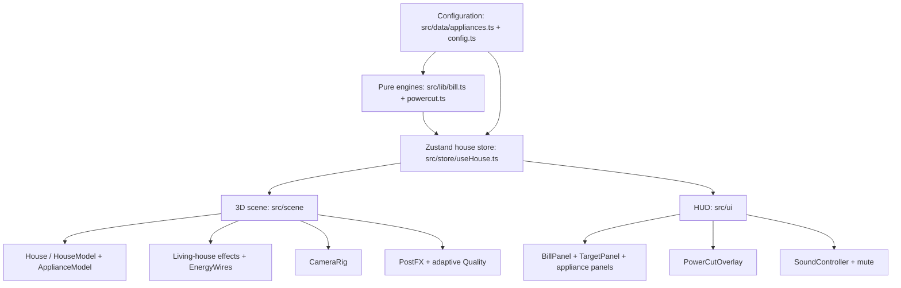

# Watt's Up?

Explore a 3D home, manage appliance use, and see how your choices change the monthly energy bill.

Live demo: **[watts-up-jade.vercel.app](https://watts-up-jade.vercel.app/)** · [Repository](https://github.com/VivekTiwary-25/watts-up)

## What it does

Built for hackathon PS-04, Watt's Up? is an interactive 3D house where you can toggle appliances, adjust their daily hours, track a live bill against a target, and respond to a simulated Power Cut by choosing exactly three appliances for the inverter.

Screenshot placeholders (add the images under `docs/screenshots/`):

- `docs/screenshots/overview.png` — house overview
- `docs/screenshots/bill-target.png` — live bill and target
- `docs/screenshots/power-cut.png` — Power Cut selection

## Features

- Intro camera shot before entering the house.
- Dollhouse overview with an orbitable camera.
- Room fly-in when you focus a room, with a return to the overview.
- Hover glow and selection outlines for appliances.
- Energy wires linking the meter to appliances.
- Living-house effects: spinning fan, TV glow, AC airflow, appliance activity, and Power Cut flicker.
- Appliance and Power Cut sounds, fan hum, and a mute control.
- Reduced-motion support for camera moves and interface animations.
- Adaptive quality: resolution and postprocessing adjust to rendering performance, with cached shadows.

## Judge quick-check

1. Toggle an appliance in the appliance list or 3D house; confirm the bill changes.
2. Adjust the target bill; confirm the progress ring and under/over amount update.
3. Start **Power Cut**, choose three appliances, and try a fourth; the fourth selection is blocked.

## Verified on the live site

Recorded live-site verification for [watts-up-jade.vercel.app](https://watts-up-jade.vercel.app/): all three judge checks passed.

- [x] **Appliance toggle:** turning on the Split AC at the default hours changes the displayed monthly bill from **Rs 798 → Rs 2,858**.
- [x] **Target feedback:** with the default target, the ring flips to over-target when the AC is enabled.
- [x] **Power Cut:** a fourth pick is blocked with "Inverter can only run 3 appliances". The result shows comfort, backup time, and cost; the best combo is **fan + fridge + lights**, with **10/12** comfort, **5h 26m** backup, and **Rs 2.12/h**. **Restore** brings back the appliance states from before the Power Cut.

## Appliances

| Appliance       | Room        | Watts | Default hours/day | Comfort |
| --------------- | ----------- | ----: | ----------------: | ------: |
| Ceiling Fan     | Living room |    75 |                10 |       3 |
| Split AC        | Bedroom     | 1,500 |                 6 |       5 |
| Refrigerator    | Kitchen     |   150 |                24 |       4 |
| Television      | Living room |   100 |                 4 |       2 |
| LED Lights      | All rooms   |    40 |                 6 |       3 |
| Washing Machine | Bathroom    |   500 |                 1 |       1 |
| Geyser          | Bathroom    | 2,000 |                 1 |       2 |
| Electric Stove  | Kitchen     | 1,500 |                 1 |       2 |

## How the bill is calculated

Monthly units for each enabled appliance are `watts × hours per day × 30 ÷ 1,000`. Energy charges use progressive slabs:

| Monthly units      | Rate per unit |
| ------------------ | ------------: |
| First 100          |            ₹4 |
| Next 100 (101–200) |            ₹6 |
| Above 200          |            ₹8 |

A fixed charge of **₹100** is added to the energy charge. Each appliance's displayed cost is its share of total units multiplied by the energy charge; the fixed charge is not allocated to appliances.

At the default settings, the enabled fan, refrigerator, television, and LED lights use **149.7 units** and the total bill is **₹798.20** (₹698.20 energy charge + ₹100 fixed charge). The bill tests check this example.

The tip identifies the enabled appliance with the largest share of usage, then estimates the bill saving from running it two fewer hours per day. It uses the same slab calculation and rounds the saving to whole rupees. With everything off, the tip says the bill is just the fixed charge.

## Power Cut

- Select exactly **3** unique appliances. A fourth selection is blocked.
- The fictional **VoltVault 1800** inverter has 1,800 Wh capacity and makes 80% usable (1,440 Wh).
- Estimated battery time is `capacity (Wh) × usable fraction ÷ selected load (W)`.
- Comfort is the sum of the selected appliance comfort scores, out of a maximum **12**.
- Estimated running cost is `selected load (W) ÷ 1,000 × ₹8 per unit` per hour.
- The app checks all **56** possible three-appliance sets, keeps those with at least **2 hours** of backup, then chooses the highest comfort score; ties go to longer battery time.
- Best eligible set: **Refrigerator + Ceiling Fan + LED Lights** — 265 W, comfort **10/12**, about **5.43 hours** of backup, and **₹2.12/hour**.

## Configuration

- Appliance names, rooms, wattage, default hours, and comfort scores: `src/data/appliances.ts`
- Tariff, inverter, Power Cut rules, target defaults, and room names: `src/data/config.ts`
- Bill and Power Cut calculations: `src/lib/bill.ts` and `src/lib/powercut.ts`

## Architecture

Appliance data and tunable configuration feed the pure bill and Power Cut engines. The Zustand house store exposes state and actions to both the 3D scene and the HUD; their controls update the same store.



## Tech stack and development

Vite, React, TypeScript, Three.js, React Three Fiber, Drei, postprocessing, Zustand, Motion, GSAP, Tailwind CSS v4, shadcn/ui, and Vitest.

```text
src/
  data/       appliances and tunable configuration
  lib/        bill and Power Cut calculations
  store/      shared house state
  scene/      interactive 3D house
  ui/         panels and overlays
public/models/  3D models and environment map
docs/screenshots/  project screenshots
```

```sh
npm i
npm run dev
npm test
npm run build
```

## How we built it

One boss agent planned the work, reviewed results, and merged branches. Worker agents (Claude, Codex, and Grok) each worked in their own branch and clone. Every worker branch was merged with `--no-ff`, keeping its work visible in `git log --graph --oneline`.

Tests were the score: run `npm test` to see the current passing test count, and `npm run build` to check the production build.

At this README update, **87 tests across 12 test files passed**, and the production build passed.

## Accessibility and performance

The appliance list and controls use native buttons and keyboard-operable switches. The interface honors `prefers-reduced-motion`. Production builds split Three.js, React Three Fiber/postprocessing, and animation libraries into vendor chunks.

## Credits

Asset attribution is **TBD** for each model and the environment map.

| Model                | Site | Link | Author | Licence |
| -------------------- | ---- | ---- | ------ | ------- |
| `fan.glb`            | TBD  | TBD  | TBD    | TBD     |
| `ac.glb`             | TBD  | TBD  | TBD    | TBD     |
| `fridge.glb`         | TBD  | TBD  | TBD    | TBD     |
| `tv.glb`             | TBD  | TBD  | TBD    | TBD     |
| `light.glb`          | TBD  | TBD  | TBD    | TBD     |
| `washer.glb`         | TBD  | TBD  | TBD    | TBD     |
| `geyser.glb`         | TBD  | TBD  | TBD    | TBD     |
| `microwave.glb`      | TBD  | TBD  | TBD    | TBD     |
| `house.glb`          | TBD  | TBD  | TBD    | TBD     |
| HDRI environment map | TBD  | TBD  | TBD    | TBD     |

All data is fictional; no external APIs, no login.
