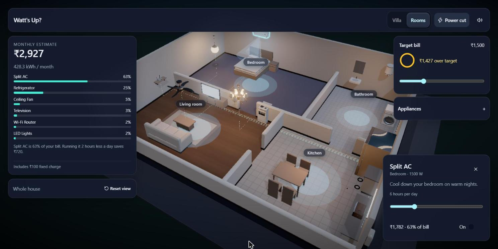
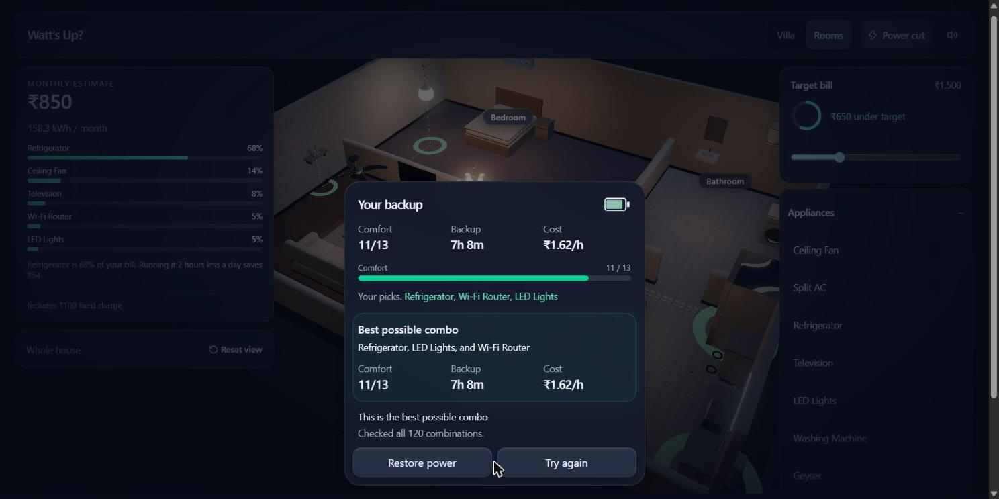
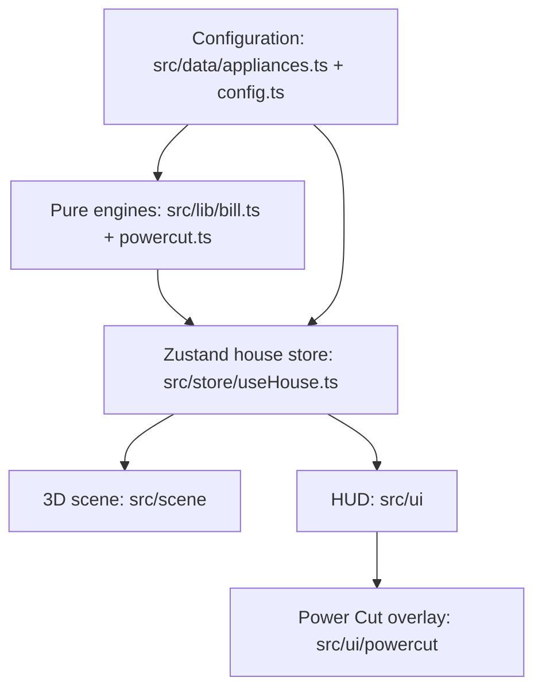

# Watt's Up?

People cannot see which appliances drive their electricity bill, or how to cope when the power goes out. Watt's Up? is an interactive 3D house that shows both.

## Features

- The monthly bill updates live as you toggle appliances or change their daily hours.
- A target bill with a progress ring shows how far under or over target you are.
- The Power Cut twist: pick exactly 3 appliances for the inverter and get a result card with the best possible combination.
- A sunset intro around a 3-level Bali hillside villa, then a furnished 3D dollhouse with real, clickable appliance models: click a room to step inside at eye height and look around (Previous / Next / Overview). A Villa / Rooms toggle shows the villa sliced open at the ground floor (section cut).
- Accessibility: `prefers-reduced-motion` is respected and the controls work from the keyboard.

## Run it

Live: **https://watts-up-jade.vercel.app/** · Repo: https://github.com/VivekTiwary-25/watts-up

```sh
npm install
npm run dev
```

Open http://localhost:5173. No env vars, no keys, no backend.

## Screenshots





## Judge demo path (3 steps, built-in sample data)

1. **Toggle appliances.** The default bill is 158.34 units, **Rs 850**. Turn on the Split AC and it becomes **Rs 2,927**.
2. **Set a target.** The default target is Rs 1,500, shown as "Rs 650 under target". Drag the target slider and watch the progress ring and the under/over text change.
3. **Trigger Power Cut.** The screen flickers, then you pick exactly 3 appliances. A 4th pick is blocked with "Inverter can only run 3 appliances". Confirm is only enabled at exactly 3. The result card shows comfort, backup hours and cost per hour. The best of all 120 combinations is fridge + router + lights: comfort 11/13, 7h 8m, Rs 1.62/h. "Restore power" returns your switches to how they were.

## Known limitations

- The AC is a stylised placeholder model, not a real scan.
- The villa is heavy (about 50 MB); it runs best on a laptop with a real GPU.
- Appliances are interactive in the Rooms view only; the Villa view is a look-only section cut at one height (no per-floor buttons yet).
- The intro's sunset lighting loads a small HDR from the drei asset CDN; offline it falls back to plain lighting.
- Tariff, battery and comfort numbers are fictional.
- Nothing is saved between visits; a reload resets everything.

## Credits

Models (same table as `public/models/CREDITS.md`):

| File | Model | Author | Source | Licence |
|---|---|---|---|---|
| house.glb | Bali Villa. 3 Level House. Hillside. Pauls Place | MarMel-Bali | https://sketchfab.com/3d-models/858e874c8b394cf9a0586fbf4515779b | CC Attribution 4.0 |
| fan.glb | Ceiling Fan | Poly Haven | https://polyhaven.com/a/ceiling_fan | CC0 |
| chandelier.glb | Chandelier 01 | Poly Haven | https://polyhaven.com/a/Chandelier_01 | CC0 |
| light.glb | Modern Ceiling Lamp 01 | Poly Haven | https://polyhaven.com/a/modern_ceiling_lamp_01 | CC0 |
| stove.glb | Electric Stove | Poly Haven | https://polyhaven.com/a/electric_stove | CC0 |
| tv.glb | Led Tv | Daniyal Malik | https://sketchfab.com/3d-models/led-tv-014e75456b4e465b9cecd1b136a0312b | CC Attribution 4.0 |
| fridge.glb | Refrigerator | FILL IN from team credits sheet (Sketchfab, Unity2Skfb export) | FILL IN | FILL IN |
| microwave.glb | Vintage Microwave | Poly Haven | https://polyhaven.com/a/vintage_microwave | CC0 |
| geyser.glb | METAL GEYSER RED STAR, BADDI, HP | NEGI PRADEEP | https://sketchfab.com/3d-models/metal-geyser-red-star-baddihp-9b0a678098974b518c8394fb37d970c4 | CC Attribution 4.0 |
| tubelight.glb | Tube Light | ROY | https://sketchfab.com/3d-models/tube-light-c0a1a915abba44319f47c87aa9c1fa52 | CC Attribution 4.0 |
| router.glb | Wi-Fi router | sam_petux | https://sketchfab.com/3d-models/wi-fi-router-271a04854baf4ebf813cfbf9c22be287 | CC Attribution 4.0 |
| washer.glb | Modern Clothes Dryer | FILL IN from team credits sheet | FILL IN | FILL IN |

All files were converted and compressed for the web (glTF-Transform: Meshopt geometry, WebP textures at max 1024px).

Libraries: React, Vite, TypeScript, three, @react-three/fiber, drei, postprocessing, zustand, motion, GSAP, Tailwind CSS v4, shadcn/ui, Vitest.

## Built with AI

Claude Code (an Opus boss agent plus Sonnet subagents), OpenAI Codex (Sol and Luna), Grok, and Claude chat for converting and compressing the 3D models.

**One thing we fixed or changed:** the villa's roof could not be removed, because its 130 parts are all named "Material". We built a section-cut view instead (a clipping plane slices the house at the ground floor). The original 249 MB house was also compressed to about 50 MB so it loads in a browser.

## Appliances

| Appliance       | Room        | Watts | Default hours/day | Comfort |
| --------------- | ----------- | ----: | ----------------: | ------: |
| Ceiling Fan     | Living room |    75 |                10 |       3 |
| Split AC        | Bedroom     | 1,500 |                 6 |       5 |
| Refrigerator    | Kitchen     |   150 |                24 |       4 |
| Television      | Living room |   100 |                 4 |       2 |
| LED Lights      | All rooms   |    40 |                 6 |       3 |
| Washing Machine | Bathroom    |   500 |                 1 |       1 |
| Geyser          | Bathroom    | 2,000 |                 1 |       2 |
| Electric Stove  | Kitchen     | 1,500 |                 1 |       2 |
| Microwave       | Kitchen     | 1,200 |               0.5 |       1 |
| Wi-Fi Router    | Living room |    12 |                24 |       4 |

## How the bill is calculated

Monthly units for each enabled appliance are `watts × hours per day × 30 ÷ 1,000`. Energy charges use progressive slabs (fictional tariff):

| Monthly units      | Rate per unit |
| ------------------ | ------------: |
| First 100          |            ₹4 |
| Next 100 (101–200) |            ₹6 |
| Above 200          |            ₹8 |

A fixed charge of **₹100** is added. Each appliance's displayed cost is its share of total units multiplied by the energy charge; the fixed charge is not allocated to appliances.

At the default settings the fan, refrigerator, television, LED lights and router use **158.34 units** and the total is **₹850.04** (shown as Rs 850: ₹750.04 energy + ₹100 fixed). The bill tests check this example.

The tip names the appliance with the largest share and estimates the saving from running it two fewer hours a day. With everything off, the tip says the bill is just the fixed charge.

## Power Cut

- Select exactly **3** unique appliances. A fourth selection is blocked.
- The fictional **VoltVault 1800** inverter has 1,800 Wh capacity, 80% usable (1,440 Wh).
- Battery time is `capacity (Wh) × usable fraction ÷ selected load (W)`.
- Comfort is the sum of the selected comfort scores, out of a maximum of **13**.
- Running cost is `selected load (W) ÷ 1,000 × ₹8` per hour.
- The app checks all **120** three-appliance sets, keeps those with at least **2 hours** of backup, then picks the highest comfort; ties go to longer battery time.
- Best set: **Refrigerator + Wi-Fi Router + LED Lights**: comfort **11/13**, **7h 8m** of backup, **Rs 1.62/hour**.

## Configuration

- Appliance names, rooms, wattage, hours, comfort: `src/data/appliances.ts`
- Tariff, inverter, Power Cut rules, target defaults: `src/data/config.ts`
- Bill and Power Cut calculations: `src/lib/bill.ts` and `src/lib/powercut.ts`

## Architecture

Appliance data and configuration feed the pure bill and Power Cut engines. The Zustand house store exposes state and actions to both the 3D scene and the HUD.



## Tech stack and development

Vite, React, TypeScript, Three.js, React Three Fiber, Drei, postprocessing, Zustand, Motion, GSAP, Tailwind CSS v4, shadcn/ui, and Vitest.

```text
src/
  data/       appliances and tunable configuration
  lib/        bill and Power Cut calculations
  store/      shared house state
  scene/      interactive 3D house
  ui/         panels and overlays
public/models/  3D models and environment map
docs/           submission docs and screenshots
```

```sh
npm install
npm run dev
npm test
npm run build
```

## How we built it

One boss agent planned the work, reviewed results, and merged branches. Worker agents (Claude, Codex, and Grok) each worked in their own branch and clone, and every branch was merged with `--no-ff` so `git log --graph --oneline` shows each worker's contribution. Tests were the score: `npm test` and `npm run build` had to pass before a branch was merged.

All data is fictional; no external APIs, no login.
