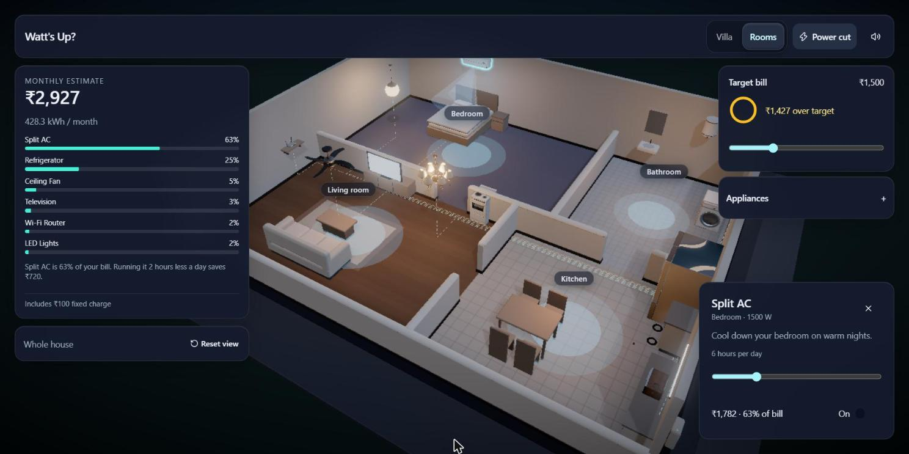
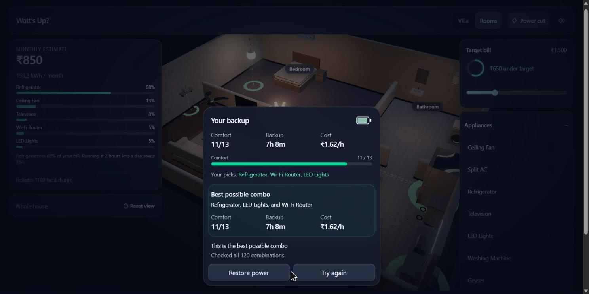

# DOC-01 Readme and quickstart

> **Click this first:** open https://watts-up-jade.vercel.app/ , enter the house, then turn on the **Split AC**. The bill jumps from Rs 850 to Rs 2,927. Then press **Power Cut**.

## Purpose

Problem (PS-04): people cannot see which appliances drive their electricity bill, or how to cope with a power cut. Watt's Up? is an interactive 3D house that shows the bill live and lets you plan for an outage.

## Features

- Live monthly bill that updates when you toggle an appliance or change its hours.
- Target bill with a progress ring and an "under / over target" message.
- Power Cut twist: pick exactly 3 appliances for the inverter; the result card shows comfort, backup hours, cost per hour and the best combination.
- 3-level Bali hillside villa with section-cut floors (Ground / First / Top) and clickable 3D appliances.
- Reduced-motion support and keyboard-operable controls.

## Setup (no secrets)

```sh
npm install
npm run dev
```

Open http://localhost:5173. There are no env vars, API keys or backend.

## Demo data

Everything is built in. 10 appliances, a 30-day month, a fictional slab tariff and a fictional "VoltVault 1800" inverter.

| Item | Value |
| --- | --- |
| Default bill | 158.34 units, Rs 850 |
| With Split AC on | Rs 2,927 |
| Default target | Rs 1,500 (Rs 650 under target) |
| Best Power Cut combo | fridge + router + lights, comfort 11/13, 7h 8m, Rs 1.62/h |

## Screenshots





## Known limitations

- The AC is a stylised placeholder model.
- The villa is heavy (about 50 MB); best on a laptop with a real GPU.
- Tariff, battery and comfort numbers are fictional.
- Nothing is saved between visits; reload resets everything.
